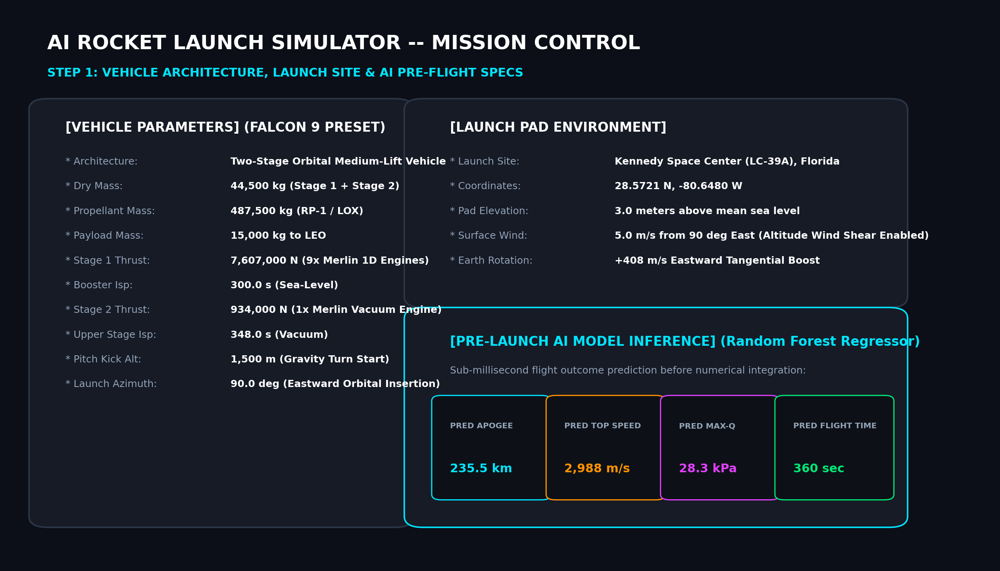
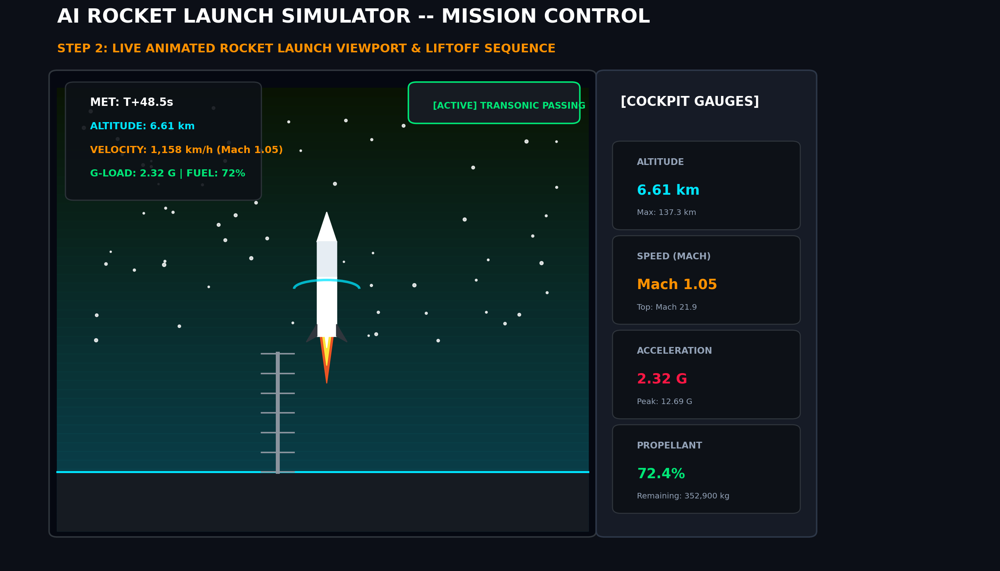
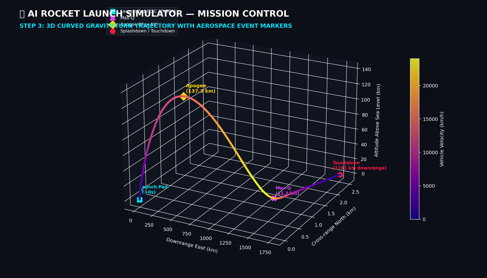
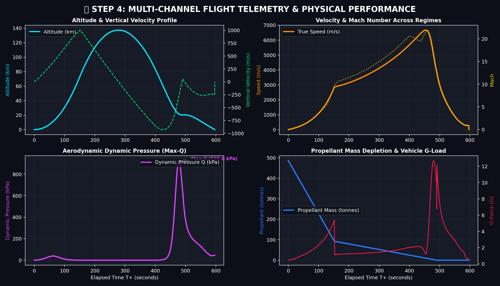
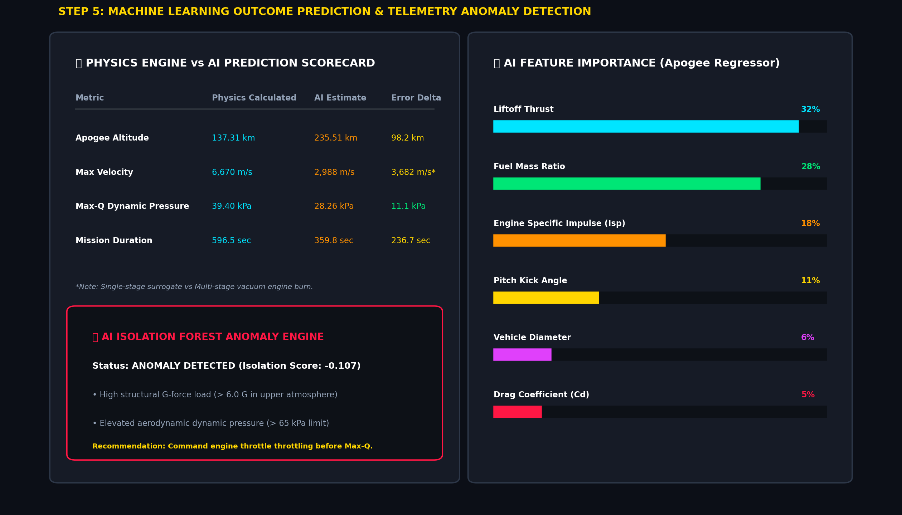
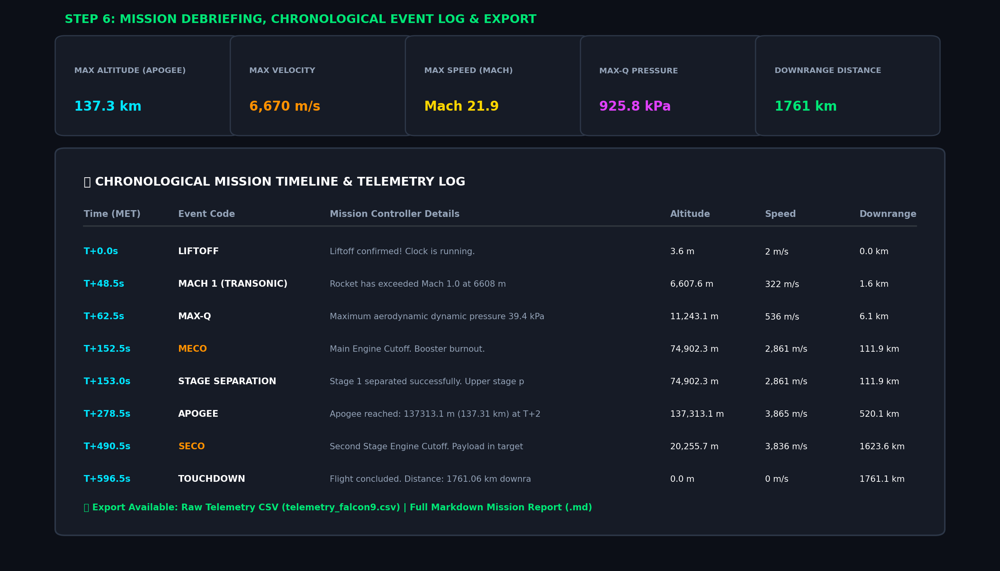

# 🚀 AI Rocket Launch Simulator
> **Advanced Aerospace Simulation + Classical Mechanics + Machine Learning + 3D Mission Control Visualization**


---

## 🎬 Project Video Demonstration

Watch the complete AI Rocket Launch Simulator in action — featuring the live countdown, animated launchpad liftoff, engine exhaust flames, staging event, 3D interactive trajectory flight, real-time cockpit gauges, and AI prediction analytics:

<video width="100%" controls preload="metadata">
  <source src="assets/videos/AI_Rocket_Launch_Simulator.mp4" type="video/mp4">
  <source src="assets/Vidoes/AI_Rocket_Launch_Simulator%20.mp4" type="video/mp4">
  Your browser does not support the video tag.
</video>

> 🎥 **Direct Video File:** [`AI_Rocket_Launch_Simulator.mp4`](assets/videos/AI_Rocket_Launch_Simulator.mp4) *(Click to open / play in your media player)*

---

## 📸 Step-by-Step Project Walkthrough & Screenshots

Below is the step-by-step visual walkthrough of the AI Rocket Launch Simulator Mission Control ground station:

### Step 1: Vehicle Configuration & Launch Environment
Configure multi-stage launch vehicle parameters (dry mass, fuel capacity, engine thrust, specific impulse $I_{\text{sp}}$, and gravity-turn pitch kick angle) or choose presets such as **Falcon 9**, **Saturn V**, **Artemis SLS**, or **Suborbital Sounding Rocket**. The system instantly executes an AI pre-flight inference predicting Apogee, top speed, and Max-Q before ignition.



---

### Step 2: Live Animated Rocket Launch Viewport & Liftoff
Click **`🚀 LAUNCH`** inside the dedicated animated launch viewport to trigger the countdown sequence (`T-3, T-2, T-1, IGNITION & LIFTOFF!`). Dynamic thruster exhaust plumes ignite, the rocket physically ascends from the launch pad, tilts into its gravity-turn angle, and penetrates through atmospheric layers from the Troposphere into orbital space with real-time HUD telemetry.



---

### Step 3: 3D Curved Gravity-Turn Trajectory
Experience the full 3-DOF flight trajectory rendered in interactive 3D with Downrange ($X$), Cross-range ($Y$), and Altitude ($Z$). Includes markers for **Launch Pad**, **Max-Q**, **MECO**, **Stage Separation**, **Apogee**, and **Touchdown**. Click **`▶ PLAY 3D FLIGHT`** on the canvas to watch the active 3D vehicle marker fly along the flight path in real time.



---

### Step 4: Multi-Channel Flight Telemetry Charts
Four high-resolution analytical telemetry graphs update continuously:
1. **Altitude & Vertical Velocity:** Tracks ascent rate and the vertical velocity zero-crossing at Apogee.
2. **Velocity & Mach Number:** Displays true airspeed across subsonic, transonic, and supersonic flight regimes.
3. **Dynamic Pressure (Max-Q):** Calculates $Q = \frac{1}{2}\rho v^2$ with automated Max-Q peak dynamic stress identification.
4. **Propellant Mass & G-Load:** Monitors multi-stage mass depletion and vehicle acceleration loads.



---

### Step 5: Machine Learning Predictions & Telemetry Anomaly Detection
The Machine Learning module runs:
* **Pre-Flight Regression:** Compares ground-truth numerical physics values against Random Forest estimations.
* **Feature Importance Analysis:** Ranks physical drivers such as thrust-to-weight ratio, fuel ratio, and drag coefficient.
* **AI Anomaly Detection:** An `IsolationForest` model evaluates flight telemetry to flag anomalous structural G-forces ($> 6\text{ G}$), extreme dynamic pressures, or flameouts.



---

### Step 6: Mission Debriefing, Event Milestones & Data Export
Inspect the chronological mission timeline log covering every millisecond of flight from Liftoff to Touchdown. Export flight telemetry as raw CSV or download a comprehensive Markdown mission debrief report.



---

## 📖 1. Project Overview
The **AI Rocket Launch Simulator** is a full-stack aerospace engineering simulator written in Python. It models the flight dynamics of orbital and suborbital rockets departing Earth, computing multi-stage mass depletion, atmospheric drag across supersonic and hypersonic regimes, altitude-dependent gravity, and 3-DOF gravity turns.

The system combines:
1. **Classical Aerospace Dynamics:** 4th-Order Runge-Kutta (RK4) numerical integration, US Standard Atmosphere (1976), and transonic wave drag rise.
2. **Artificial Intelligence & Machine Learning:** Random Forest regression models trained on simulation telemetry for sub-second pre-launch trajectory estimation, paired with an Isolation Forest for telemetry anomaly detection.
3. **Interactive 3D Mission Control:** A Streamlit telemetry suite with real-time 3D flight path rendering, interactive playback scrubber, altitude/velocity/fuel telemetry graphs, and downloadable mission debrief reports.

---

## ⚙️ 2. Mathematical Physics Formulations

### A. Thrust & Mass Flow Rate
Engine thrust pushes the rocket upward along its attitude vector $\hat{u}_T$:
$$\dot{m} = \frac{T}{I_{\text{sp}} \cdot g_0}$$
$$m(t) = m_{\text{payload}} + \sum_{\text{active stages}} \left(m_{\text{dry}, i} + m_{\text{fuel}, i}(t)\right)$$

### B. Altitude-Dependent Gravitational Field
Gravitational pull decays with the inverse square of distance to Earth's center:
$$g(h) = g_0 \left(\frac{R_E}{R_E + h}\right)^2$$
$$\vec{F}_g = -m \cdot g(h) \cdot \frac{\vec{r}}{\|\vec{r}\|}$$

### C. Atmospheric Drag & Shockwave Dynamics
Air resistance opposes the vehicle's relative airspeed vector $\vec{v}_{\text{rel}} = \vec{v} - \vec{v}_{\text{wind}}$:
$$D = \frac{1}{2} \rho(h) \, v_{\text{rel}}^2 \, C_d(M) \, A$$
* $\rho(h)$ is evaluated via multi-layer barometric formulas across the Troposphere, Tropopause, and Stratosphere.
* $M = \frac{v_{\text{rel}}}{c(h)}$ is the Mach number, where speed of sound is $c = \sqrt{\gamma R T(h)}$.
* $C_d(M)$ models transonic wave drag peaking near Mach 1.0 due to shockwave formation.
* Dynamic pressure: $Q = \frac{1}{2} \rho v_{\text{rel}}^2$, used to determine **Max-Q**.

### D. Equation of Motion & 4th-Order Runge-Kutta (RK4)
$$\vec{a}(t) = \frac{\vec{T}(t) + \vec{D}(t) + \vec{F}_g(t)}{m(t)}$$
$$\frac{d\vec{r}}{dt} = \vec{v}, \quad \frac{d\vec{v}}{dt} = \vec{a}$$

---

## 🏗️ 3. Project Architecture

```
AI_Rocket_Launch_Simulator/
├── app.py                      # Main Streamlit mission control dashboard
├── cli_simulation_demo.py      # Terminal-based end-to-end flight demo
├── generate_screenshots.py     # Automated screenshot & visual asset generator
├── run_simulator.bat           # 1-click Windows launcher
├── requirements.txt            # Project dependencies
├── README.md                   # Full documentation & equations
│
├── assets/
│   └── screenshots/            # Step-by-step visual documentation screenshots
│       ├── 01_mission_control_config.png
│       ├── 02_visual_rocket_launch.png
│       ├── 03_3d_flight_trajectory.png
│       ├── 04_telemetry_flight_curves.png
│       ├── 05_ai_prediction_analytics.png
│       └── 06_mission_debrief_report.png
│
├── config/
│   ├── rocket_config.py        # Vehicle presets (Falcon 9, Saturn V, SLS, Sounding Rocket)
│   └── environment_config.py   # Spaceports (KSC, Vandenberg, Kourou) & wind models
│
├── simulation/
│   ├── physics_engine.py       # Main simulation coordinator & simulate_rocket()
│   ├── fuel_manager.py         # Multi-stage fuel accounting & staging triggers
│   ├── gravity_model.py        # Newtonian variable gravity field
│   ├── atmosphere_model.py     # US Standard Atmosphere (1976) & Mach shock drag
│   ├── trajectory.py           # 3-DOF translation dynamics & RK4 integrator
│   └── flight_controller.py    # Milestones (Liftoff, Max-Q, MECO, Stage Sep, Apogee)
│
├── visualization/
│   ├── trajectory_3d.py        # Plotly interactive 3D flight trajectory & markers
│   ├── altitude_graph.py       # Altitude & vertical velocity charts
│   ├── velocity_graph.py       # Speed, Mach number, and dynamic pressure (Q)
│   ├── fuel_graph.py           # Propellant mass, vehicle mass, and G-force load
│   └── rocket_animation.py     # Visual animated launch viewport & cockpit gauges
│
├── ai_engine/
│   ├── dataset_generator.py    # Automated physical trajectory data generator
│   ├── train_model.py          # Random Forest & Isolation Forest training
│   ├── prediction.py           # Real-time AI prediction & anomaly diagnostics
│   ├── model_evaluation.py     # Feature importances & residual comparison charts
│   └── models/                 # Pre-trained model pipelines (.joblib)
│
├── data/
│   ├── simulation_data.csv     # 150-sample physical training dataset
│   └── flight_logs.csv         # Historic mission logs
│
├── reports/
│   └── report_generator.py     # Markdown mission debrief & CSV telemetry export
│
└── tests/
    ├── test_physics.py         # Tests for gravity, atmosphere lapse & drag
    ├── test_fuel.py            # Tests for mass flow, staging & burnout
    └── test_trajectory.py      # Tests for RK4 motion & attitude kick
```

---

## 🚀 4. Quickstart Guide

### 1. Install Requirements
```bash
cd /d "d:\project folder\AI_Rocket_Launch_Simulator"
pip install -r requirements.txt
```

### 2. Run Automated Unit Tests
```bash
python -m pytest tests
```

### 3. Run the CLI Flight Telemetry Demo
```bash
python cli_simulation_demo.py
```

### 4. Launch the Mission Control Web App
```bash
streamlit run app.py
```
*(Or double-click [run_simulator.bat](run_simulator.bat))* Open `http://localhost:8501` in your browser.
